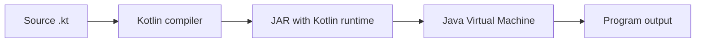

<div align="center">

# Kotlin

### Kotlin/JVM Development Guide


[Overview](#overview) · [Installation](#installation) · [Usage](#usage) · [Compilation](#compilation) · [Troubleshooting](#troubleshooting)

[Return to project README](../README.md)

</div>

---

## Overview

Kotlin is a statically typed language supporting object-oriented and functional programming. This project uses standalone Kotlin/JVM programs without requiring Gradle or an IDE.

### Container environment

Eclipse Temurin JDK 21 and Kotlin compiler 2.2.21, installed by `docker/Dockerfile.kotlin`.

## Prerequisites

Docker Desktop with Linux containers enabled, PowerShell, and the downloaded project repository. Follow the [root installation guide](../README.md#installation). Native compiler installation is not required.

## Installation

Run the following commands from the **repository root**, not this language directory. If you are currently in `Kotlin/`, run `cd ..` first.

```powershell
docker compose build kotlin
docker compose run --rm kotlin --version
docker compose run --rm kotlin --list
. .\profile.ps1
```

The build is normally required only once or after changes to the Dockerfile or runner. Docker Desktop must be running during execution.

## Usage

| Programming concept | Companion program | Comparative analysis program |
| --- | --- | --- |
| Data Types and Type Systems | `dtts.kt` → `kotlin-dtts` | `dtts-docs.kt` → `kotlin-dtts-docs` |
| Object-Oriented Programming | `oop.kt` → `kotlin-oop` | `oop-docs.kt` → `kotlin-oop-docs` |
| Subprograms and Parameter Passing | `spp.kt` → `kotlin-spp` | `spp-docs.kt` → `kotlin-spp-docs` |
| Exception Handling | `eh.kt` → `kotlin-eh` | `eh-docs.kt` → `kotlin-eh-docs` |

The companion programs use themed practical examples; the `for-docs/` programs use Student Record examples for the comparative term paper.

### Execute a program

```powershell
kotlin-dtts
kotlin-dtts-docs
```

### Select a program dynamically

```powershell
kweng
kweng dtts
```

### Direct Docker execution

```powershell
docker compose run --rm kotlin dtts
docker compose run --rm kotlin dtts-docs
docker compose run --rm kotlin --list
docker compose run --rm kotlin --version
```

The final argument is processed by `scripts/run-kotlin.sh`. Program names are discovered dynamically from source filenames, without the `.kt` extension. Filenames must be unique within the language directory.

## Compilation



The runner searches for a unique `.kt` filename, creates a temporary directory, and executes the equivalent of:

```bash
kotlinc dtts.kt -include-runtime -d program.jar
java -jar program.jar
```

The JAR includes the Kotlin runtime. The runner removes temporary files after execution. Each example should be a standalone source file with an executable main function.

### Updating source files

Edit source files in `Kotlin/` using your preferred editor. The Compose bind mount makes the latest files available inside the container. Run the program again to compile your changes; no image rebuild is needed. After adding, renaming, or deleting files, run `weng-refresh` to update the shortcuts.

If you change `scripts/run-kotlin.sh` or `docker/Dockerfile.kotlin`, rebuild:

```powershell
docker compose build kotlin
```

## Troubleshooting

| Issue | Resolution |
| --- | --- |
| Docker unavailable | Open Docker Desktop and verify `docker version` |
| Program not found | Run `docker compose run --rm kotlin --list` and check the filename |
| Duplicate filenames | Give each source a unique base name |
| `exec format error` | Ensure runner uses UTF-8 without BOM, LF line endings and a Bash entrypoint; rebuild |
| Compilation failed | Inspect the compiler output and fix the source code |
| PowerShell shortcut unavailable | From the root, run `. .\profile.ps1` again |

If Java or Kotlin cannot be located, rebuild the Kotlin image and repeat the version check. If no main manifest is generated, verify that the selected file contains an executable `main` function.

## Resources

- [Kotlin documentation](https://kotlinlang.org/docs/home.html)
- [Kotlin command-line compiler](https://kotlinlang.org/docs/command-line.html)
- [Docker Compose documentation](https://docs.docker.com/compose/)

---

<div align="center">

**Kotlin · Containerized compilation and execution**

</div>
