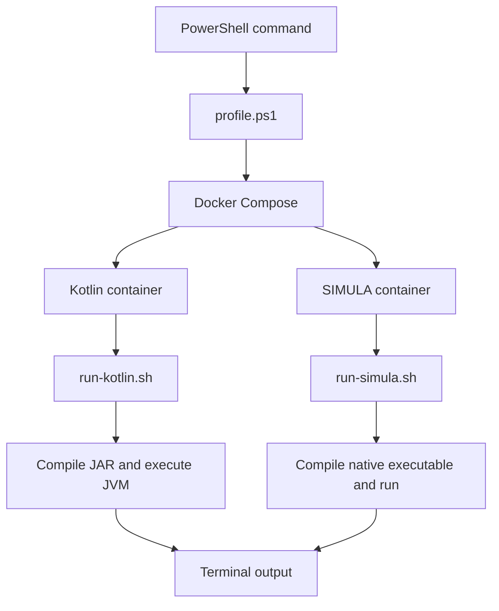

<div align="center">

# Final Project — Team WengWeng

### CCS 238 — Comparative Term Paper

Object-Oriented Programming from Simula 67 to Kotlin: A Comparative Analysis of Classes and Inheritance


[Overview](#overview) · [Installation](#installation) · [Usage](#usage) · [Architecture](#architecture) · [Troubleshooting](#troubleshooting)

</div>

---

## Overview

This project demonstrates four programming language concepts using Kotlin and SIMULA 67. Docker provides isolated compiler environments, while PowerShell shortcuts automate compilation and execution. Docker is the required execution environment; native compiler installation is not necessary.

| Concept | Kotlin | SIMULA 67 |
| --- | --- | --- |
| Data Types and Type Systems | `kotlin-dtts` | `simula-dtts` |
| Exception Handling | `kotlin-eh` | `simula-eh` |
| Object-Oriented Programming | `kotlin-oop` | `simula-oop` |
| Subprograms and Parameter Passing | `kotlin-spp` | `simula-spp` |

The repository contains 16 source files: eight companion programs and eight Student Record comparative analysis programs, covering four concepts in both languages. The comparative analysis programs are located in each language’s `for-docs/` directory.

## Prerequisites

- Windows 10 or 11 supported by Docker Desktop, with hardware virtualization enabled.
- Docker Desktop with the WSL 2 backend and Linux containers enabled.
- PowerShell and an internet connection for the initial image build.
- Git (optional; downloading a ZIP is also supported).
- Sufficient disk space for Docker images and build cache.

## Installation

### 01 — Install Docker Desktop

Download [Docker Desktop](https://www.docker.com/products/docker-desktop/) and follow the installation instructions. Enable WSL 2 if requested, restart if necessary, and open Docker Desktop.

Verify in PowerShell:

```powershell
docker --version
docker compose version
docker info --format '{{.OSType}}'
docker run --rm hello-world
```

The OS type should be `linux`. The hello-world container should execute successfully.

### 02 — Download the repository

On GitHub, select **Code → Download ZIP**, extract the archive, and open the extracted repository root. Alternatively, clone using the URL from the GitHub Code menu.

In File Explorer, type `powershell` in the address bar and press Enter. Confirm that `compose.yaml` and `profile.ps1` are present:

```powershell
Get-ChildItem
```

### 03 — Build the environments

```powershell
docker compose config --services
docker compose build
docker image ls
```

The configured services should include `kotlin` and `simula`. The initial build downloads base images, compilers, and dependencies. Later builds can reuse cached layers.

### 04 — Verify the compilers

```powershell
docker compose run --rm kotlin --version
docker compose run --rm simula --version
docker compose run --rm kotlin --list
docker compose run --rm simula --list
```

Confirm that both version checks succeed and the required source programs appear in the lists.

### 05 — Load the PowerShell commands

Review `profile.ps1`, then run:

```powershell
. .\profile.ps1
```

The leading dot followed by a space loads the functions into the current PowerShell session. It does not require editing your personal PowerShell profile. Repeat this step when opening a new terminal.

## Usage

### PowerShell shortcuts

```powershell
weng-help
kotlin-dtts
simula-dtts
kotlin-dtts-docs
simula-dtts-docs
```

| Command | Purpose |
| --- | --- |
| `kotlin-dtts`, `simula-dtts` | Data types and type systems |
| `kotlin-eh`, `simula-eh` | Exception handling |
| `kotlin-oop`, `simula-oop` | Object-oriented programming |
| `kotlin-spp`, `simula-spp` | Subprograms and parameter passing |
| `kweng`, `sweng` | List and select a program |
| `kweng filename`, `sweng filename` | Execute a source file by its base name |
| `weng-check` | Verify Docker and compiler environments |
| `weng-build` | Build both environments |
| `weng-help` | Display available shortcuts |
| `weng-list` | List source programs |
| `weng-refresh` | Refresh generated shortcuts |
| `kotlin-dtts-docs`, `simula-dtts-docs` | Run Student Record examples (also available for `oop`, `spp`, `eh`) |

### Direct Docker commands

Docker remains required even when the PowerShell shortcuts are not loaded.

```powershell
docker compose run --rm kotlin dtts
docker compose run --rm simula dtts
docker compose run --rm kotlin dtts-docs
docker compose run --rm simula dtts-docs
```

`run` creates a one-time container; `--rm` removes it after execution, not the image. The service name selects the environment, and the final argument selects the program. `--list` and `--version` are custom runner arguments.

## Architecture



### Repository structure

```text
.
├── Kotlin/
│   ├── Data_Type-and-Type_Systems/dtts.kt
│   ├── Exception_Handling/eh.kt
│   ├── Object-Oriented_Programming/oop.kt
│   ├── Subprograms-and-Parameter_Passing/spp.kt
│   ├── for-docs/
│   │   ├── dtts-docs.kt
│   │   ├── eh-docs.kt
│   │   ├── oop-docs.kt
│   │   └── spp-docs.kt
│   └── README.md
├── Simula-67/
│   ├── Data_Type-and-Type_Systems/dtts.sim
│   ├── Exception_Handling/eh.sim
│   ├── Object-Oriented_Programming/oop.sim
│   ├── Subprograms-and-Parameter_Passing/spp.sim
│   ├── for-docs/
│   │   ├── dtts-docs.sim
│   │   ├── eh-docs.sim
│   │   ├── oop-docs.sim
│   │   └── spp-docs.sim
│   └── README.md
├── docker/
│   ├── Dockerfile.kotlin
│   └── Dockerfile.simula
├── scripts/
│   ├── run-kotlin.sh
│   └── run-simula.sh
├── compose.yaml
├── profile.ps1
├── .dockerignore
├── .gitattributes
└── README.md
```

Each language directory contains its programming concept examples.

| Component | Responsibility |
| --- | --- |
| Dockerfiles | Build compiler environments and define entrypoints |
| Docker images | Reusable packages containing installed compilers and runners |
| Containers | Temporary isolated execution instances |
| `compose.yaml` | Defines services, builds, source mounts and terminal settings |
| `profile.ps1` | Registers convenient PowerShell commands |
| Bash runners | Locate sources, compile, execute and clean temporary files |
| `.dockerignore` | Excludes unnecessary files from build context |
| `.gitattributes` | Maintains Linux-compatible script line endings |

### Updating the project

Source directories are mounted read-only into containers. Editing, adding or deleting source files requires no image rebuild. Each execution compiles the current source.

| Change | Action |
| --- | --- |
| Edit `.kt` or `.sim` | Run again |
| Add, rename or delete source files | `weng-refresh` |
| `profile.ps1` | Reload `. .\profile.ps1` |
| Bash runner or Dockerfile | `docker compose build` |
| Compose configuration | `docker compose config`; rebuild if build settings changed |

## Troubleshooting

| Issue | Resolution |
| --- | --- |
| Docker daemon unavailable | Start Docker Desktop and wait for the engine |
| `exec format error` | Save Bash scripts as UTF-8 without BOM and LF; use explicit Bash entrypoints; rebuild |
| Program not found | Use `--list`; omit the source extension; check source mount paths |
| Duplicate source filenames | Rename conflicting files within the same language |
| PowerShell command not recognized | Reload the repository profile in the current terminal |
| Script execution restricted | Use direct Docker commands or consult the system administrator |
| Compilation error | Read compiler output and correct the source |
| Empty `docker compose images` | Use `docker image ls`; one-shot containers may already be removed |

For a clean rebuild, use `docker compose build --no-cache`. This is not required for ordinary source changes.

## Language guides

- [Kotlin — Docker development guide](./Kotlin/README.md)
- [SIMULA 67 — Docker development guide](./Simula-67/README.md)

## Resources

- [Docker Desktop](https://docs.docker.com/desktop/)
- [Docker Compose](https://docs.docker.com/compose/)
- [PowerShell documentation](https://learn.microsoft.com/powershell/)

---

<div align="center">

**One repository. Two languages. Consistent execution.**

</div>
