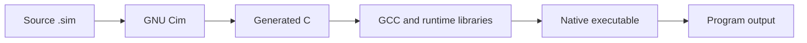

<div align="center">

# SIMULA 67

### GNU Cim Development Guide


[Overview](#overview) · [Installation](#installation) · [Usage](#usage) · [Compilation](#compilation) · [Troubleshooting](#troubleshooting)

[Return to project README](../README.md)

</div>

---

## Overview

SIMULA 67 is a pioneering object-oriented programming language. This project uses GNU Cim to translate SIMULA source into C and compile a native executable with GCC.

### Container environment

Ubuntu 24.04, GNU Cim, GCC, CMake, Bison, Flex and required runtime files, prepared by `docker/Dockerfile.simula`.

## Prerequisites

Docker Desktop with Linux containers enabled, PowerShell, and the downloaded project repository. Follow the [root installation guide](../README.md#installation). Native compiler installation is not required.

## Installation

Run the following commands from the **repository root**, not this language directory. If you are currently in `Simula-67/`, run `cd ..` first.

```powershell
docker compose build simula
docker compose run --rm simula --version
docker compose run --rm simula --list
. .\profile.ps1
```

The build is normally required only once or after changes to the Dockerfile or runner. Docker Desktop must be running during execution.

## Usage

| Programming concept | Companion program | Comparative analysis program |
| --- | --- | --- |
| Data Types and Type Systems | `dtts.sim` → `simula-dtts` | `dtts-docs.sim` → `simula-dtts-docs` |
| Object-Oriented Programming | `oop.sim` → `simula-oop` | `oop-docs.sim` → `simula-oop-docs` |
| Subprograms and Parameter Passing | `spp.sim` → `simula-spp` | `spp-docs.sim` → `simula-spp-docs` |
| Exception Handling | `eh.sim` → `simula-eh` | `eh-docs.sim` → `simula-eh-docs` |

The companion programs use themed practical examples; the `for-docs/` programs use Student Record examples for the comparative term paper.

### Execute a program

```powershell
simula-dtts
simula-dtts-docs
```

### Select a program dynamically

```powershell
sweng
sweng dtts
```

### Direct Docker execution

```powershell
docker compose run --rm simula dtts
docker compose run --rm simula dtts-docs
docker compose run --rm simula --list
docker compose run --rm simula --version
```

The final argument is processed by `scripts/run-simula.sh`. Program names are discovered dynamically from source filenames, without the `.sim` extension. Filenames must be unique within the language directory.

## Compilation



The runner searches for a unique `.sim` filename, copies it into a temporary build directory as `program.sim`, and prepares compiler attribute files (`.atr`) and runtime objects (`simfile.o`, `simenvir.o`) from `/opt/simula-runtime`. It then executes:

```bash
gnucim program.sim
./program
```

The temporary directory is removed after execution. No manual runtime setup is required. The runner is designed for standalone source examples; programs requiring additional source files may need runner changes.

### Updating source files

Edit source files in `Simula-67/` using your preferred editor. The Compose bind mount makes the latest files available inside the container. Run the program again to compile your changes; no image rebuild is needed. After adding, renaming, or deleting files, run `weng-refresh` to update the shortcuts.

If you change `scripts/run-simula.sh` or `docker/Dockerfile.simula`, rebuild:

```powershell
docker compose build simula
```

## Troubleshooting

| Issue | Resolution |
| --- | --- |
| Docker unavailable | Open Docker Desktop and verify `docker version` |
| Program not found | Run `docker compose run --rm simula --list` and check the filename |
| Duplicate filenames | Give each source a unique base name |
| `exec format error` | Ensure runner uses UTF-8 without BOM, LF line endings and a Bash entrypoint; rebuild |
| Compilation failed | Inspect the compiler output and fix the source code |
| PowerShell shortcut unavailable | From the root, run `. .\profile.ps1` again |

If GNU Cim reports missing attribute or runtime files, check the Dockerfile runtime-copy steps and rebuild the SIMULA image. If GNU Cim rejects syntax, consult its supported SIMULA dialect; Docker does not change compiler language support.

The `--version` runner argument reports the GNU Cim executable location, GCC version and runtime files; it does not establish the GNU Cim release number. Record the compiler source revision separately for reproducibility.

## Resources

- [GNU Cim source repository](https://github.com/sergev/simula-compiler)
- [Ubuntu documentation](https://documentation.ubuntu.com/)
- [Docker Compose documentation](https://docs.docker.com/compose/)

---

<div align="center">

**SIMULA 67 · Containerized compilation and execution**

</div>
